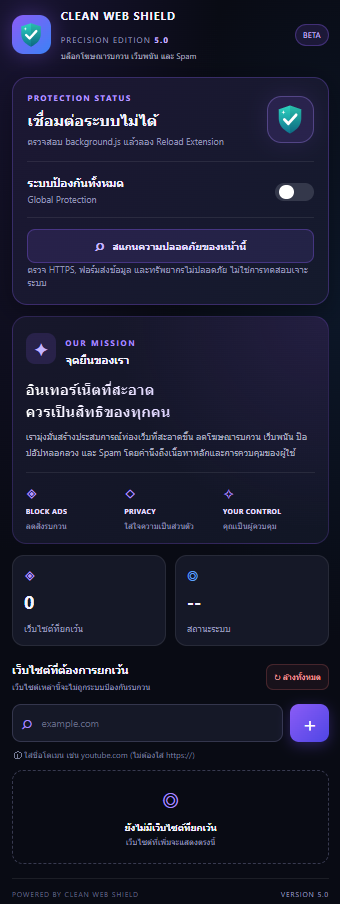

<div align="center">

# 🛡️ Clean Web Shield (Precision Edition)

**ส่วนขยายเบราว์เซอร์สำหรับ Chromium ที่ช่วยกรองคำขอโฆษณา ซ่อนองค์ประกอบรบกวน และจัดการโฆษณาวิดีโอได้อย่างแม่นยำ**


<br />



</div>

<br />

> [!NOTE]
> การกรองและซ่อนโฆษณาอาศัยกฎและตัวเลือก CSS/DOM ที่ระบุไว้ในโปรเจกต์ จึงอาจไม่ครอบคลุมโฆษณาทุกเว็บไซต์ และในบางกรณีอาจซ่อนองค์ประกอบที่เว็บไซต์ใช้แสดงเนื้อหาปกติได้

---

## ✨ ความสามารถหลัก

| หมวดหมู่ | รายละเอียดการทำงาน |
| :--- | :--- |
| 🚫 **Network Filtering** | ใช้ **Declarative Net Request** บล็อกคำขอเครือข่ายที่ตรงกับรูปแบบใน `rules.json` ตั้งแต่ระดับเบราว์เซอร์ |
| 🧹 **DOM & CSS Cleanup** | ใช้ Content Script ตรวจจับและลบโฆษณาบนหน้าเว็บ พร้อมซ่อนแบนเนอร์ ลิงก์ และกรอบโฆษณาด้วย CSS Selector |
| 🎬 **Video Ad Handling** | บน **YouTube** และเว็บเล่นวิดีโอ ช่วยข้ามหรือปิดเสียงโฆษณาวิดีโออัตโนมัติ รวมถึงลบโฆษณาแทรกบางชนิด |
| 🎛️ **Flexible Control** | เปิด-ปิดการป้องกันทั้งหมดได้จากปุ่มส่วนขยาย หรือเลือก **พักการป้องกันรายเว็บไซต์** (ทั้งจากแท็บปัจจุบันหรือเพิ่มโดเมนเอง) |
| 🔍 **Local URL Scanner** | สแกนสัญญาณความเสี่ยงจาก URL แบบออฟไลน์ในเครื่อง โดย **ไม่ส่งข้อมูล** ออกไปยังเซิร์ฟเวอร์ภายนอก |
| 🎨 **Theme Support** | รองรับการสลับธีม **สว่าง / มืด (Light / Dark Mode)** พร้อมจดจำค่าที่เลือกไว้อัตโนมัติ |

---

## 🚀 วิธีติดตั้งใน Chrome หรือ Chromium

1. **ดาวน์โหลดโปรเจกต์:** ดาวน์โหลดไฟล์ ZIP หรือโคลน Repository นี้ลงในเครื่องของคุณ
   ```bash
   git clone <repository-url>
- เปิดหน้าจัดการส่วนขยาย: พิมพ์ chrome://extensions ในแถบที่อยู่ของเบราว์เซอร์แล้วกด Enter

- เปิดโหมดนักพัฒนา: เปิดสวิตช์ Developer mode ที่มุมขวาบน

- โหลดส่วนขยาย: คลิกปุ่ม Load unpacked (โหลดส่วนขยายที่ยังไม่ได้แพ็ก)

- เลือกโฟลเดอร์: เลือกโฟลเดอร์หลักของโปรเจกต์ที่มีไฟล์ manifest.json อยู่

```cmd
💡 Tip: หากมีการแก้ไขโค้ดหรือกฎในไฟล์ส่วนขยาย ให้กดปุ่ม Reload (🔄) บนการ์ดของส่วนขยายในหน้า chrome://extensions เพื่ออัปเดตการเปลี่ยนแปลง
```

📂 โครงสร้างโปรเจกต์

```Plaintext
clean-web-shield/
├── 📁 icons/               # ไอคอนของส่วนขยายในขนาดต่างๆ
├── 📄 manifest.json        # การตั้งค่าหลักของส่วนขยาย สิทธิ์การเข้าถึง กฎเครือข่าย และ Scripts
├── 📄 popup.html           # โครงสร้างหน้าต่างควบคุม (Popup UI)
├── 📄 popup.css            # สไตล์และธีม (Light/Dark) ของหน้าต่างควบคุม
├── 📄 popup.js             # ลอจิกการควบคุมการป้องกัน รายชื่อเว็บไซต์ การสแกน URL และธีม
├── 📄 background.js        # Service Worker บันทึกการตั้งค่าและซิงก์กฎตามเว็บที่ยกเว้น
├── 📄 rules.json           # กฎ Declarative Net Request สำหรับบล็อกคำขอโฆษณา
├── 📄 content.js           # สคริปต์ตรวจสอบและจัดการโฆษณาใน DOM รวมถึงตัวเล่นวิดีโอ
├── 📄 styles.css           # กฎ CSS สำหรับซ่อนองค์ประกอบโฆษณาตาม Selector
└── 📄 inject.js            # สคริปต์สำหรับดักจับการเรียกใช้ window.open
```

🔐 สิทธิ์การเข้าถึง (Permissions)
ในไฟล์ `manifest.json` ส่วนขยายมีการขอสิทธิ์ดังต่อไปนี้:


- declarativeNetRequest: เพื่อใช้บล็อกคำขอเครือข่ายตามกฎที่กำหนดไว้ได้อย่างรวดเร็วและปลอดภัย

- `<all_urls>` (Host Permissions): เพื่อให้กฎเครือข่ายและ Content Scripts สามารถทำงานครอบคลุมทุกเว็บไซต์ที่คุณเข้าชม

โปรดตรวจสอบโค้ดและสิทธิ์ทั้งหมดก่อนทำการติดตั้งหรือใช้งาน


⚠️ ข้อควรทราบและข้อจำกัด


- การปรับแต่งกฎเครือข่าย: rules.json ใช้รูปแบบ Regex ในการจับคู่ URL และชนิดคำขอ การแก้ไขกฎเองอาจทำให้ทรัพยากรปกติของเว็บไซต์ถูกบล็อกไปด้วย

- ความเข้ากันได้กับตัวเล่นวิดีโอ: การจัดการโฆษณาวิดีโอบางส่วนอาศัยการตรวจจับระยะเวลาและโครงสร้าง DOM ของเว็บไซต์ ซึ่งอาจต้องอัปเดตหากเว็บไซต์ต้นทางเปลี่ยนโครงสร้าง

- ลำดับความสำคัญของปุ่มควบคุม: สวิตช์หลักจะควบคุมการทำงานทั้งหมด ส่วนการปิดรายเว็บไซต์ (Whitelist) จะยกเว้นทั้งโดเมนหลักและโดเมนย่อย โดยจะมีผลเฉพาะเมื่อเปิดสวิตช์หลักไว้เท่านั้น

- การทำงานของตัวสแกน URL: ระบบตรวจสอบความเสี่ยงเป็นเพียงการวิเคราะห์รูปแบบ (Heuristic) จากข้อความ URL ในเครื่องเท่านั้น ไม่ได้ตรวจสอบเนื้อหาจริงของหน้าเว็บหรือฐานข้อมูลชื่อเสียง จึงไม่สามารถยืนยันความปลอดภัยของเว็บไซต์ได้ 100%

- สถานะของ inject.js: แม้ไฟล์ inject.js จะถูกระบุไว้ใน web_accessible_resources แล้ว แต่ใน manifest.json ปัจจุบันยังไม่ได้สั่งฉีด (Inject) ไฟล์นี้เข้าสู่หน้าเว็บ ฟังก์ชันดักจับ window.open ในไฟล์ดังกล่าวจึงยังไม่ทำงานในเวอร์ชันนี้

